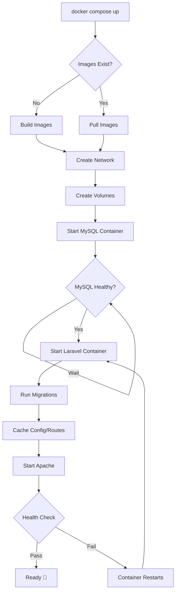

# NutriTrace Docker Architecture

## 🏗️ System Architecture

```
┌─────────────────────────────────────────────────────────────────────┐
│                          Docker Host (Your PC)                       │
│                                                                      │
│  ┌────────────────────────────────────────────────────────────┐    │
│  │                    Docker Compose Network                   │    │
│  │                    (nutritrace-network)                     │    │
│  │                                                             │    │
│  │  ┌─────────────────┐      ┌─────────────────┐             │    │
│  │  │  Laravel App    │      │   MySQL 8.0     │             │    │
│  │  │  (nutritrace-app)│◄────►│ (nutritrace-db) │             │    │
│  │  │                 │      │                 │             │    │
│  │  │  - PHP 8.3      │      │  - Database     │             │    │
│  │  │  - Apache       │      │  - Port: 3306   │             │    │
│  │  │  - Laravel 13   │      │  - Persistent   │             │    │
│  │  │  - Port: 8000   │      │    Volume       │             │    │
│  │  │                 │      │                 │             │    │
│  │  └────────┬────────┘      └─────────────────┘             │    │
│  │           │                                                │    │
│  │           │ HTTP (AI calls)                                │    │
│  │           │                                                │    │
│  │           ▼                                                │    │
│  │  ┌─────────────────┐                                      │    │
│  │  │ host.docker.    │ (Option A - Recommended)             │    │
│  │  │  internal:8001  │◄─────────────────┐                  │    │
│  │  └─────────────────┘                  │                  │    │
│  │           │                            │                  │    │
│  └───────────┼────────────────────────────┼──────────────────┘    │
│              │                            │                       │
│              │                            │                       │
│              ▼                            │                       │
│  ┌─────────────────────┐                 │                       │
│  │  AI Service (Host)  │                 │                       │
│  │  Port: 8001         │                 │                       │
│  │  - GPU Access       │                 │                       │
│  │  - Python 3.11      │                 │                       │
│  │  - FastAPI          │                 │                       │
│  │  - PyTorch + CUDA   │                 │                       │
│  └─────────────────────┘                 │                       │
│              OR                           │                       │
│  ┌─────────────────────┐                 │                       │
│  │ AI Service (Docker) │                 │ (Option B)            │
│  │ (nutritrace-ai)     │◄────────────────┘                       │
│  │ Port: 8001          │                                         │
│  │ - CPU Only          │                                         │
│  │ - Models Volume     │                                         │
│  └─────────────────────┘                                         │
│                                                                   │
└───────────────────────────────────────────────────────────────────┘
```

## 📊 Data Flow

### User Request Flow

```
┌─────────┐
│ Browser │
└────┬────┘
     │ HTTP Request
     │ http://localhost:8000
     ▼
┌─────────────────────┐
│   Host Machine      │
│   Port 8000         │
└─────────┬───────────┘
          │ Port Mapping
          ▼
┌─────────────────────┐
│  Docker Container   │
│  nutritrace-app     │
│                     │
│  ┌───────────────┐  │
│  │ Apache :80    │  │
│  │      ▼        │  │
│  │  Laravel App  │  │
│  └───────┬───────┘  │
│          │          │
│    ┌─────▼─────┐    │
│    │ Controller│    │
│    └─────┬─────┘    │
│          │          │
│    ┌─────▼─────┐    │
│    │  Service  │    │
│    └─────┬─────┘    │
└──────────┼──────────┘
           │
     ┌─────┴──────┬──────────────┐
     │            │              │
     ▼            ▼              ▼
┌─────────┐  ┌─────────┐  ┌──────────┐
│ MySQL   │  │ AI API  │  │  Cache   │
│ :3306   │  │ :8001   │  │ (Volume) │
└─────────┘  └─────────┘  └──────────┘
```

## 🔄 Container Lifecycle



## 🗂️ Volume Structure

### Database Volume (db_data)
```
/var/lib/mysql/
├── nutritrace/           # Database files
│   ├── lots.ibd
│   ├── events.ibd
│   ├── organizations.ibd
│   └── ...
├── mysql/                # System tables
└── performance_schema/   # Performance data
```

### Application Storage (app_storage)
```
/var/www/html/storage/
├── app/
│   ├── public/          # User uploads (QR codes, certificates)
│   └── private/
├── framework/
│   ├── cache/          # Application cache
│   ├── sessions/       # User sessions
│   └── views/          # Compiled Blade templates
└── logs/
    └── laravel.log     # Application logs
```

## 🔐 Network Security

```
┌─────────────────────────────────────────────────┐
│         External Network (Internet)              │
└─────────────────┬───────────────────────────────┘
                  │
                  │ Expose Port 8000
                  ▼
┌─────────────────────────────────────────────────┐
│            Docker Host Firewall                  │
└─────────────────┬───────────────────────────────┘
                  │
                  ▼
┌─────────────────────────────────────────────────┐
│      Docker Bridge Network (Isolated)            │
│                                                  │
│  ┌─────────┐    ┌─────────┐    ┌─────────┐     │
│  │   App   │◄──►│   DB    │◄──►│   AI    │     │
│  │  :8000  │    │  :3306  │    │  :8001  │     │
│  └─────────┘    └─────────┘    └─────────┘     │
│                                                  │
│  Internal DNS: app, db, ai                      │
│  No external access to db or ai                 │
└─────────────────────────────────────────────────┘
```

## 🚀 Build Process

### Laravel App Build

```
┌─────────────────────────────────────────┐
│         Stage 1: Frontend Builder        │
│         (node:22-alpine)                 │
│                                          │
│  1. Copy package.json                    │
│  2. npm ci --ignore-scripts              │
│  3. Copy source files                    │
│  4. npm run build                        │
│     └─> public/build/                    │
│         (CSS, JS bundles)                │
└─────────────────┬───────────────────────┘
                  │ Copy artifacts
                  ▼
┌─────────────────────────────────────────┐
│         Stage 2: PHP Runtime             │
│         (php:8.3-apache)                 │
│                                          │
│  1. Install system dependencies          │
│  2. Install PHP extensions               │
│  3. Configure Apache                     │
│  4. Copy composer files                  │
│  5. composer install                     │
│  6. Copy application code                │
│  7. Copy built assets from Stage 1       │
│  8. Optimize autoloader                  │
│  9. Set permissions                      │
└─────────────────────────────────────────┘
                  │
                  ▼
            Final Image (~500MB)
```

### AI Service Build

```
┌─────────────────────────────────────────┐
│         Python 3.11 Base                 │
│                                          │
│  1. Install system dependencies          │
│  2. Copy requirements.txt                │
│  3. pip install (PyTorch, FastAPI, etc.) │
│  4. Copy application code                │
│  5. Create model directories             │
└─────────────────────────────────────────┘
                  │
                  ▼
            Final Image (~3GB with PyTorch)
```

## ⚙️ Configuration Layers

```
┌─────────────────────────────────────────┐
│     Configuration Priority (High to Low) │
├─────────────────────────────────────────┤
│  1. Environment Variables (docker-compose)│
│     - Highest priority                   │
│     - Runtime configuration              │
│                                          │
│  2. .env File (mounted volume)           │
│     - Laravel specific config            │
│     - Can override defaults              │
│                                          │
│  3. config/*.php (Laravel)               │
│     - Default values                     │
│     - Read from env()                    │
│                                          │
│  4. Dockerfile ENV                       │
│     - Build-time defaults                │
│     - Lowest priority                    │
└─────────────────────────────────────────┘
```

## 🔄 Deployment Scenarios

### Development (Current Setup)

```
Developer Machine
├── Code editing (host)
├── Git operations (host)
├── Docker containers
│   ├── Laravel app (isolated)
│   ├── MySQL (isolated)
│   └── Volumes (persistent)
└── AI service (host with GPU)
```

### Staging/Testing

```
Cloud Server (e.g., AWS EC2)
├── Docker containers
│   ├── Laravel app
│   ├── MySQL
│   └── AI service (CPU or GPU instance)
├── Reverse proxy (nginx)
│   └── SSL certificates
└── CI/CD pipeline deploys here
```

### Production (Future)

```
Kubernetes Cluster
├── Pods
│   ├── Laravel app (multiple replicas)
│   ├── AI service (GPU node)
│   └── Worker queues
├── Services
│   ├── Load balancer
│   └── Internal networking
├── External Services
│   ├── Managed MySQL (RDS)
│   ├── Redis cache (ElastiCache)
│   └── S3 storage
└── Monitoring
    ├── Prometheus
    └── Grafana
```

## 📈 Scaling Strategies

### Horizontal Scaling (Multiple Instances)

```
┌─────────────┐
│ Load Balancer│
└──────┬──────┘
       │
   ┌───┴───┐
   │       │
   ▼       ▼
┌────┐  ┌────┐  ┌────┐
│App1│  │App2│  │App3│  (Laravel containers)
└─┬──┘  └─┬──┘  └─┬──┘
  │       │       │
  └───────┴───────┘
          │
          ▼
    ┌──────────┐
    │  MySQL   │  (Single instance)
    └──────────┘
```

### Vertical Scaling (Resource Allocation)

```yaml
# docker-compose.yml
services:
  app:
    deploy:
      resources:
        limits:
          cpus: '2.0'
          memory: 2G
        reservations:
          cpus: '1.0'
          memory: 1G
```

## 🎯 Key Takeaways

1. **Isolation**: Each service runs in its own container
2. **Portability**: Same setup works on any Docker-enabled machine
3. **Persistence**: Data survives container restarts via volumes
4. **Security**: Network isolation, no root processes
5. **Flexibility**: Choose GPU (host) or CPU (container) for AI
6. **Scalability**: Easy to add replicas or resources

## 📚 Related Documentation

- [Main Docker Guide](README.md) - Setup and usage
- [docker-compose.yml](../docker-compose.yml) - Service definitions
- [Dockerfiles](../NutriTrace/) - Build instructions
